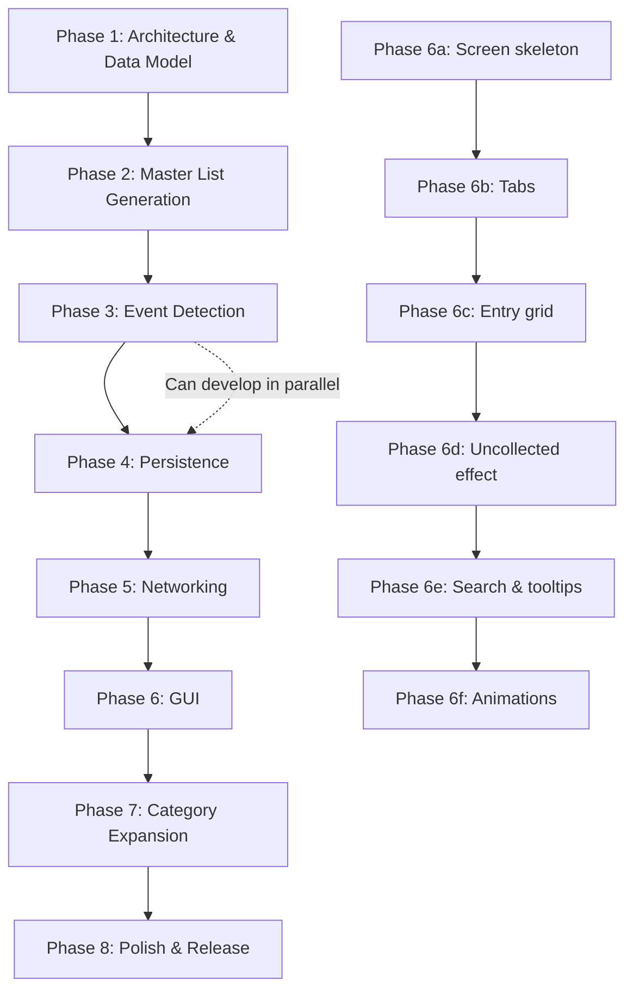

# Collection Log Mod — Implementation Roadmap

> Structured specification intended for both human developers and AI assistants resuming work on this project. Each phase is independently actionable and references concrete NeoForge 1.21.1 APIs.

---

## 0. Project Metadata

| Field | Value |
|---|---|
| Mod ID | `itemcollector` |
| Root package | `io.github.codetimmy.itemcollector` |
| Minecraft | `1.21.1` |
| NeoForge | `21.1.264` (minimum), range `[21.1.264,22.0)` |
| Java | `21` |
| Build system | Gradle with `net.neoforged.moddev` plugin |
| Loader range | `[4,)` |
| License | `GPL-3.0` |
| Current version | `0.1.0` |
| Target side | `BOTH` (server-authoritative progress, client UI) |
| Reference mod | [Collect Everything](https://modrinth.com/mod/collect-everything) |

### Source layout

```
src/main/java/io/github/codetimmy/itemcollector/
├── ItemCollectorMod.java              # @Mod entry point
├── collection/
│   ├── CollectionCategory.java        # enum
│   ├── CollectibleEntry.java          # record
│   ├── CollectibleRegistry.java       # master list builder
│   └── CollectionProgressData.java    # SavedData
├── event/
│   ├── ProgressEvents.java            # server-side detection
│   └── TickEvents.java                # biome/structure polling
├── network/
│   ├── NetworkHandler.java            # payload registration
│   ├── SyncMasterListPayload.java
│   └── SyncProgressPayload.java
├── client/
│   ├── ClientPayloadHandler.java
│   ├── CollectionScreen.java
│   ├── CollectionMenu.java
│   └── widget/
│       ├── TabButton.java
│       └── EntryGrid.java
└── config/
    └── CollectionConfig.java

src/main/resources/
├── META-INF/neoforge.mods.toml
└── assets/itemcollector/
    ├── lang/en_us.json
    └── textures/gui/
```

---

## 1. Phase Dependency Graph



**Critical path for MVP:** `P1 → P2 → P3 → P4 → P5 → P6` for the **`ITEMS` category only**. All other categories (Phase 7) are repetition of the same pipeline.

---

## 2. Phase 1 — Architecture & Data Model

**Goal:** Define all core types and storage strategy before writing logic.

**Files touched:** `collection/CollectionCategory.java`, `collection/CollectibleEntry.java`

### Tasks

- [ ] Define `CollectionCategory` enum with values: `ITEMS, BLOCKS, ENTITIES, BIOMES, STRUCTURES, EFFECTS, ENCHANTMENTS, ADVANCEMENTS`
- [ ] Define `CollectibleEntry` record:
  ```java
  public record CollectibleEntry(
      ResourceLocation id,
      Component displayName,
      CollectionCategory category,
      @Nullable CompoundTag extraData   // entity variants, etc.
  ) {}
  ```
- [ ] Document the two-store persistence model in a `README.md` under `collection/`:
  - **Store A — master list:** what *can* be collected; rebuilt each startup from registries
  - **Store B — progress:** what *has been* collected; persisted via `SavedData`

### Design decisions (log here when changed)

| Decision | Chosen | Alternatives | Reason |
|---|---|---|---|
| Progress storage | `SavedData` on Overworld | Data attachments on `ServerPlayer` | Simpler for "Together" mode merge; single file |
| Master list transport | Full sync on join | Chunked / on-demand | Small enough for ~2k entries; chunking added if packet > 1 MB |
| Entity variant key | `CompoundTag` in `extraData` | Subclass per entity | Schema-free, survives mod updates |

**Done when:** Types compile and no registry/event code exists yet.

---

## 3. Phase 2 — Master List Generation

**Goal:** Build the list of all collectible entries at server start.

**Files touched:** `collection/CollectibleRegistry.java`, `event/ServerLifecycleEvents.java`

### Registries to iterate

All via `net.minecraft.core.registries.BuiltInRegistries`. Iterate with:

```java
for (Map.Entry<ResourceKey<T>, T> entry : BuiltInRegistries.<REGISTRY>.entrySet()) {
    ResourceLocation id = entry.getKey().location();
    // ...
}
```

| Category | Registry field | Notes |
|---|---|---|
| `ITEMS` | `BuiltInRegistries.ITEM` | Skip `AIR` |
| `BLOCKS` | `BuiltInRegistries.BLOCK` | Skip `AIR`, technical blocks |
| `ENTITIES` | `BuiltInRegistries.ENTITY_TYPE` | Skip non-spawnable (`!type.canSummon()`) |
| `BIOMES` | `BuiltInRegistries.BIOME` | Skip `minecraft:the_void` optionally |
| `STRUCTURES` | `BuiltInRegistries.STRUCTURE` | |
| `EFFECTS` | `BuiltInRegistries.MOB_EFFECT` | |
| `ENCHANTMENTS` | `BuiltInRegistries.ENCHANTMENT` | |
| `ADVANCEMENTS` | **Not a registry** | Query `server.getAdvancements().getAllAdvancements()` |

### Tasks

- [ ] Implement `CollectibleRegistry.rebuild(ServerLevel level)` — clears and repopulates `Map<CollectionCategory, List<CollectibleEntry>>`
- [ ] Register `ServerStartedEvent` listener → call `CollectibleRegistry.rebuild(server.overworld())`
- [ ] Implement `CreativeModeTabs` ordering for `ITEMS`/`BLOCKS`: iterate `CreativeModeTabs.allTabs()`, collect `ItemStack`s in order, then append remaining registry entries
- [ ] Implement blacklist filter (config-driven, see Phase 8) — predicate on `ResourceLocation.getPath()`
- [ ] Enumerate entity variants: for entities with `EntityDataAccessor` variants (Sheep color, Villager profession, Axolotl color, etc.), create one `CollectibleEntry` per variant with `extraData` populated

### Gotchas

- **Never** query registries during `RegisterEvent` or mod construction — entries are incomplete.
- `ServerStartedEvent` fires **after** the server has fully loaded all datapacks, so advancement list is complete.
- Store the sorted list, not a `Set`, to preserve creative-tab order in the UI.

**Done when:** A debug command `/collection dump` prints the count of entries per category and the first 5 IDs of each.

---

## 4. Phase 3 — Event Detection

**Goal:** Mark entries as collected when the player interacts with them.

**Files touched:** `event/ProgressEvents.java`, `event/TickEvents.java`

### Event-to-category mapping

All handlers must gate on `!level.isClientSide()` before touching progress.

| Category | Event class | Extraction |
|---|---|---|
| `ITEMS` | `ItemEntityPickupEvent.Post` | `event.getOriginalStack().getItem()` → `BuiltInRegistries.ITEM.getKey(item)` |
| `BLOCKS` | `BlockEvent.BreakEvent` | `event.getState().getBlock()` → `BuiltInRegistries.BLOCK.getKey(block)` |
| `ENTITIES` | `LivingDeathEvent` | `event.getEntity().getType()` → registry key; read variant via `instanceof` checks |
| `ADVANCEMENTS` | `AdvancementEvent.AdvancementEarnEvent` | `event.getAdvancement().id()` |
| `EFFECTS` | `MobEffectEvent.Applicable` | `event.getEffectInstance().getEffect()` holder |
| `ENCHANTMENTS` | `ItemEntityPickupEvent.Post` + scan stack `getEnchantments()` | each `Holder<Enchantment>` |
| `BIOMES` | **Polling** — `PlayerTickEvent.Post` every 20 ticks | `level.getBiome(player.blockPosition())` |
| `STRUCTURES` | **Polling** — same tick, same throttle | `level.structureManager().getStructureWithPieceAt(pos, tag)` |

### Tasks

- [ ] Implement `ProgressEvents` with `@EventBusSubscriber(modid = MODID, value = Dist.DEDICATED_SERVER)` — **not** client dist
- [ ] Implement `TickEvents` with a per-player tick counter (`Map<UUID, Integer>` in a `WeakHashMap`) to throttle polling to once per second
- [ ] Route all detections through a single method:
  ```java
  CollectionProgressData.get(server).markCollected(player.getUUID(), category, entryId);
  ```
- [ ] Fire a `SyncProgressPayload` (Phase 5) after each successful mark — debounce to max 4 packets/sec/player

### Gotchas

- `BlockEvent.BreakEvent` fires on both sides — always check `isClientSide()`.
- `ItemEntityPickupEvent.Post` — the player is `event.getEntity()`; use `getOriginalStack()` not `getCurrentStack()`.
- Advancement IDs include `minecraft:recipes/...` — filter these out or they'll bloat the list (decision: filter by `Advancement#display().isEmpty()`).
- Structure polling at `player.blockPosition()` misses structures the player walks past but doesn't enter — acceptable for v1; note as future enhancement.

**Done when:** Manually breaking a block or picking up an item logs `[ItemCollector] marked <id> for <player>`.

---

## 5. Phase 4 — Persistence

**Goal:** Save and load progress across server restarts.

**Files touched:** `collection/CollectionProgressData.java`

### Schema

```java
public class CollectionProgressData extends SavedData {
    // UUID -> (Category -> Set<ResourceLocation>)
    private final Map<UUID, Map<CollectionCategory, Set<ResourceLocation>>> progress;

    public static final SavedDataType<CollectionProgressData> TYPE =
        new SavedDataType<>(
            "collection_progress",        // file name: collection_progress.dat
            CollectionProgressData::new,
            /* Codec */ ...,
            /* DataFixTypes */ null
        );
}
```

### Tasks

- [ ] Implement `SavedDataType` with a `Codec` that serializes `Map<UUID, Map<CollectionCategory, Set<ResourceLocation>>>`
  - Use `Codec.unboundedMap(Codec.STRING.xmap(UUID::fromString, UUID::toString), ...)`
- [ ] `markCollected` must call `setDirty()` — required for write-back
- [ ] Static accessor:
  ```java
  public static CollectionProgressData get(MinecraftServer server) {
      return server.overworld().getDataStorage()
          .computeIfAbsent(TYPE, "collection_progress");
  }
  ```
- [ ] Add "Together" mode toggle in config: when `true`, all marks write to a fixed UUID `SERVER_UUID = new UUID(0,0)` instead of the player UUID; UI reads from `SERVER_UUID`

### Gotchas

- **`setDirty()` is mandatory** — without it, data is lost on shutdown.
- `SavedData` is loaded lazily; `computeIfAbsent` handles creation.
- For "Together" mode, if switching modes mid-world, merge existing per-player sets into `SERVER_UUID` on first load (one-shot migration).

**Done when:** Collect item → `/stop` → restart → item still shows as collected.

---

## 6. Phase 5 — Networking

**Goal:** Sync master list + progress to client.

**Files touched:** `network/NetworkHandler.java`, `network/SyncMasterListPayload.java`, `network/SyncProgressPayload.java`, `client/ClientPayloadHandler.java`

### Payload definitions

```java
public record SyncMasterListPayload(
    Map<CollectionCategory, List<CollectibleEntry>> entries
) implements CustomPacketPayload {
    public static final Type<SyncMasterListPayload> TYPE = ...;
    public static final StreamCodec<RegistryFriendlyByteBuf, SyncMasterListPayload> STREAM_CODEC = ...;
}

public record SyncProgressPayload(
    Set<ResourceLocation> collected,   // flat across all categories for simplicity
    boolean togetherMode
) implements CustomPacketPayload { ... }
```

### Tasks

- [ ] `NetworkHandler.register(RegisterPayloadHandlersEvent event)` — call `event.registrar("1")` and register both payloads with `playToClient`
- [ ] `ClientPayloadHandler` — annotated `@EventBusSubscriber(value = Dist.CLIENT, bus = Mod.EventBusSubscriber.Bus.MOD)` — registers `RegisterClientPayloadHandlersEvent` handlers
- [ ] Send `SyncMasterListPayload` on `PlayerEvent.PlayerLoggedInEvent` and after `/reload`
- [ ] Send `SyncProgressPayload` on login + after each debounced progress mark
- [ ] `ClientCollectionCache` — static `Map` on client populated by payload handlers; UI reads from this, not from the server

### Packet size guard

- Calculate approximate size before send: `entries.size() * ~64 bytes`. If > 900 KB, split into chunks with an index field (add `chunkIndex` / `chunkCount` to `SyncMasterListPayload`). Implement chunking only if needed — the current mod's list is small enough.

**Done when:** Join a server, open screen, all entries render with correct collected state.

---

## 7. Phase 6 — GUI

**Goal:** Tabbed collection screen with filtering, tooltips, and animations.

**Files touched:** everything under `client/`

### 6a. Screen skeleton

- [ ] `CollectionMenu extends AbstractContainerMenu` — no slots, just a marker + open/close
- [ ] Register `MenuType<CollectionMenu>` via `DeferredRegister<MenuType<?>>`
- [ ] `RegisterMenuScreensEvent` → `event.register(COLLECTION_MENU.get(), CollectionScreen::new)`
- [ ] Keybind: `RegisterKeyMappingsEvent` in `client/`; default `KEY_C` (unbound by default — user binds it)

### 6b. Tabs

- [ ] `TabButton` widget extending `AbstractWidget`, renders icon + label
- [ ] Horizontal row at top of screen; active tab highlighted
- [ ] Tab switch sets `activeCategory` and resets scroll position

### 6c. Entry grid

- [ ] `EntryGrid` widget — grid layout, `cellSize = 20`, 9 columns, scrollable vertical
- [ ] Render icons:
  - Items/Blocks: `guiGraphics.renderItem(new ItemStack(item), x, y)`
  - Entities: use spawn egg `ItemStack` as v1 fallback; see "Future" below for 3D rendering
- [ ] Scroll via `mouseScrolled(double, double, double, double)`

### 6d. Uncollected effect

- [ ] If `!cache.isCollected(id)`: render icon at alpha `0.3f`
- [ ] Draw a subtle overlay (`0x80808080`) via `guiGraphics.fill(...)` after the item render

### 6e. Search & tooltips

- [ ] `EditBox` at top for search; `keyPressed` updates `searchQuery`
- [ ] Filter displayed entries: `entry.displayName().getString().toLowerCase().contains(query.toLowerCase())`
- [ ] On hover: `guiGraphics.renderTooltip(font, entry.displayName(), mouseX, mouseY)`

### 6f. Animations

- [ ] Track `long lastTabSwitchMillis` — animate tab underline with a `fraction = (now - lastSwitch) / 200.0` easing curve
- [ ] Entry appearance: fade alpha `Math.min(1f, (now - lastRenderChange) / 300f)`

### Future enhancement (v0.2+)

- [ ] 3D entity previews using `Fancy Entity Renderer` (NeoForge 1.21.1 compatible) or NeoForge **PiP** (`PictureInPictureRenderer`)

**Done when:** Screen opens with keybind, shows all categories in tabs, collected vs. uncollected visually distinct, search filters live.

---

## 8. Phase 7 — Category Expansion

**Goal:** Replicate the pipeline (Phase 2 → 3 → 5) for every remaining category.

**Pattern per category** (mechanical, ~1 hour each once Items work):

| Step | Action |
|---|---|
| 1 | Add entry to `CollectionCategory` enum (if not already) |
| 2 | Add registry iteration block in `CollectibleRegistry.rebuild` |
| 3 | Add event listener in `ProgressEvents` **or** tick handler in `TickEvents` |
| 4 | Add tab in `CollectionScreen` |
| 5 | Add category-specific icon renderer (entity: spawn egg; effect: effect texture; enchantment: enchanted book) |

**Order of implementation (lowest complexity first):**

1. `BLOCKS` — identical to `ITEMS`
2. `ENCHANTMENTS` — same pickup event, different extraction
3. `EFFECTS` — single event, easy
4. `ADVANCEMENTS` — needs `AdvancementManager` query, filter recipes
5. `ENTITIES` — variant enumeration
6. `BIOMES` — tick polling
7. `STRUCTURES` — tick polling, most complex due to structure tags

---

## 9. Phase 8 — Polish & Release

### Tasks

- [ ] **Config** (`config/CollectionConfig.java`) via `ModConfigSpec`:
  - `enabledCategories` — `List<CollectionCategory>`
  - `blacklistIds` — `List<String>` (regex)
  - `togetherModeDefault` — `boolean`
  - `pollIntervalTicks` — `int`, default `20`
- [ ] **Commands** (`/collection`):
  - `/collection open` — opens screen (client)
  - `/collection reset <player>` — clears progress (op 2)
  - `/collection stats` — prints per-category counts (op 2)
- [ ] **Localization** — `assets/itemcollector/lang/en_us.json` with all category + GUI strings
- [ ] **Advancement integration** — optionally award a custom advancement when a category reaches 100%
- [ ] **Performance profile** — verify polling cost with 10 entities in loaded chunks
- [ ] **CI** — GitHub Actions workflow (already drafted) builds on push; artifact upload with `if-no-files-found: error`
- [ ] **Release checklist**:
  - [ ] Bump `mod_version` in `gradle.properties`
  - [ ] Update `CHANGELOG.md`
  - [ ] Tag commit `v<version>`
  - [ ] Attach `build/libs/itemcollector-<version>.jar` to GitHub release
  - [ ] Publish to Modrinth / CurseForge with screenshots

---

## 10. Reference Tables

### NeoForge event classes used

| Event | Bus | Side | Purpose |
|---|---|---|---|
| `RegisterPayloadHandlersEvent` | Mod | BOTH | Register network payloads |
| `RegisterClientPayloadHandlersEvent` | Mod | CLIENT | Register client-side payload handlers |
| `RegisterMenuScreensEvent` | Mod | CLIENT | Bind `MenuType` → `Screen` |
| `RegisterKeyMappingsEvent` | Mod | CLIENT | Register keybind |
| `ServerStartedEvent` | Game | DEDICATED_SERVER | Trigger master list build |
| `PlayerEvent.PlayerLoggedInEvent` | Game | BOTH | Send initial sync |
| `ItemEntityPickupEvent.Post` | Game | BOTH | Item detection |
| `BlockEvent.BreakEvent` | Game | BOTH | Block detection |
| `LivingDeathEvent` | Game | BOTH | Entity detection |
| `AdvancementEvent.AdvancementEarnEvent` | Game | BOTH | Advancement detection |
| `PlayerTickEvent.Post` | Game | BOTH | Biome/structure polling |

### `BuiltInRegistries` fields used

```
ITEM, BLOCK, ENTITY_TYPE, BIOME, STRUCTURE, MOB_EFFECT, ENCHANTMENT
```

### SavedData identifiers

| Data | File | Attached to |
|---|---|---|
| `collection_progress` | `<world>/data/collection_progress.dat` | Overworld `ServerLevel` |

### Payload IDs

| ID | Direction | Trigger |
|---|---|---|
| `itemcollector:sync_master_list` | S → C | Login, `/reload` |
| `itemcollector:sync_progress` | S → C | Login, progress mark (debounced) |

---

## 11. Known Gotchas (consolidated)

1. **Registry access timing** — never during `RegisterEvent` or mod constructor.
2. **`BlockEvent.BreakEvent` fires on both sides** — guard with `!level.isClientSide()`.
3. **`SavedData.setDirty()` is mandatory** — silent failure otherwise.
4. **`ItemEntityPickupEvent.Post.getOriginalStack()`** — not `getCurrentStack()`.
5. **Advancement IDs include recipes** — filter `Advancement#display().isEmpty()`.
6. **Entity variants** — Sheep color, Villager profession, Axolotl color, etc. all need explicit enumeration.
7. **Structure polling** — `player.blockPosition()` misses walking-past cases; acceptable for v1.
8. **`neoforge.mods.toml` expansion** — every `${...}` placeholder must exist in `processResources.replaceProperties` map (see prior build failure).
9. **`gradlew` must be committed** — otherwise CI fails with `chmod: cannot access 'gradlew'`.
10. **`ResourceKey` import** — `net.minecraft.resources.ResourceKey` is required for `BuiltInRegistries.X.entrySet()` loops.

---

## 12. Open Questions

| # | Question | Status |
|---|---|---|
| Q1 | Should "Together" mode be per-world or per-server? | Open — default per-world |
| Q2 | Chunked sync for large packs (ATM10)? | Defer until packet size > 900 KB observed |
| Q3 | 3D entity preview via Fancy Entity Renderer vs. PiP? | Defer to v0.2 |
| Q4 | Behavior on mod removal (entry no longer in registry)? | Keep in progress data, mark as "orphaned" in UI |
| Q5 | Compatibility with `/reload` (datapack changes)? | Rebuild master list, retain progress for surviving IDs |

---

## 13. Milestones

| Milestone | Definition of Done |
|---|---|
| **M1 — Data model** | `CollectibleEntry`, `CollectionCategory`, `CollectionProgressData` compile |
| **M2 — Items end-to-end** | Pick up item → log confirms mark → restart persists → debug command lists it |
| **M3 — UI MVP** | Screen opens, shows item tab, collected vs. uncollected distinct |
| **M4 — Networking complete** | Multiplayer: two players see separate progress; "Together" merges |
| **M5 — All categories** | Every category in Phase 7 works end-to-end |
| **M6 — v1.0.0 release** | Config, commands, localization, CI, Modrinth page |
