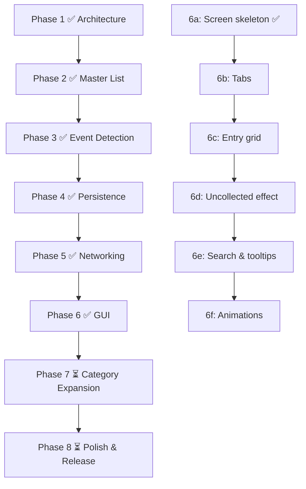

# Collection Log Mod — Implementation Roadmap (v2)

> **Status snapshot:** Phases 1–6 ✅ complete. Bug-fix interruption in progress before Phase 7. Phases 7–8 ⏳ pending.
>
> This revision reflects the **actual APIs and quirks encountered during implementation** for NeoForge 1.21.1. Sections marked **[CORRECTED]** contain a deviation from the original plan that must be respected by any future contributor (human or AI). Status legend: ✅ done · 🚧 in progress · ⏳ pending · ⚠️ known issue.

---

## 0. Project Metadata

| Field | Value |
|---|---|
| Mod ID | `itemcollector` |
| Root package | `io.github.codetimmy.itemcollector` |
| Minecraft | `1.21.1` |
| NeoForge | `21.1.264` (minimum), range `[21.1.264,22.0)` |
| Java | `21` |
| Build system | Gradle + `net.neoforged.moddev` plugin |
| Loader range | `[4,)` |
| License | `GPL-3.0` |
| Current version | `0.1.0` |
| Target side | `BOTH` |
| Reference mod | [Collect Everything](https://modrinth.com/mod/collect-everything) |

### Current source layout

```
src/main/java/io/github/codetimmy/itemcollector/
├── ItemCollectorMod.java                    ✅
├── collection/
│   ├── CollectionCategory.java              ✅
│   ├── CollectibleEntry.java                ✅
│   ├── CollectibleRegistry.java             ✅
│   └── CollectionProgressData.java          ✅ [CORRECTED: SavedData.Factory]
├── event/
│   ├── ServerLifecycleEvents.java           ✅ (master list + login sync)
│   ├── ProgressEvents.java                  ✅
│   └── TickEvents.java                      ✅ [CORRECTED: Registries.STRUCTURE]
├── network/
│   ├── NetworkHandler.java                  ✅
│   ├── SyncMasterListPayload.java           ✅
│   └── SyncProgressPayload.java             ✅
└── client/
    ├── ClientEvents.java                    ✅ (keybind handler)
    ├── ClientModEvents.java                 ✅ (keybind + menu screen registration)
    ├── ClientPayloadHandler.java            ✅ (payload cache)
    ├── CollectionMenu.java                  ✅ (no-slot menu)
    ├── CollectionScreen.java                🚧 (tabs + entry grid)
    └── widget/
      ├── EntryGrid.java                   ✅
      └── TabButton.java                   ✅
```

Directories still to be created:

```
├── command/                                 ⏳ Phase 8
└── config/                                  ⏳ Phase 8
```

---

## 1. Phase Dependency Graph



**Current position:** Phase **6 complete**. Temporarily paused for bug fixes before starting Phase 7.

---

## 2. Phase 1 — Architecture & Data Model ✅

**Goal:** Define core types.

### Files

- `collection/CollectionCategory.java` — enum with 8 values
- `collection/CollectibleEntry.java` — record `(ResourceLocation id, Component displayName, CollectionCategory category, @Nullable CompoundTag extraData)`

### Implementation notes

- Compact constructor enforces non-null on `id`, `displayName`, `category`.
- Convenience constructor for non-variant entries; `hasVariantData()` helper for Phase 7.

**Status:** ✅ Compiles, no deviations from plan.

---

## 3. Phase 2 — Master List Generation ✅

**Goal:** Build `Map<CollectionCategory, List<CollectibleEntry>>` at server start.

### Files

- `collection/CollectibleRegistry.java`
- `event/ServerLifecycleEvents.java` (registers `ServerStartedEvent`)

### What works

- `ITEMS` and `BLOCKS` populated with **creative-tab ordering**, deduplicated via `LinkedHashSet<ResourceLocation>`, fallback pass appends non-tab entries.
- `ADVANCEMENTS` populated from `server.getAdvancements().getAllAdvancements()`, filtering `display().isEmpty()`.
- All other categories are **empty placeholders** — Phase 7 will fill them.
- Log line confirms entry counts on startup.

### [CORRECTED] — Registry access facts for 1.21.1

| Fact | Detail |
|---|---|
| `BuiltInRegistries.STRUCTURE` **does not exist** | Structures are a datapack registry. Access via `level.registryAccess().registryOrThrow(Registries.STRUCTURE)`. |
| `BuiltInRegistries.BIOME` **does not exist** | Biomes are accessed via `level.registryAccess().registryOrThrow(Registries.BIOME)`. `BuiltInRegistries.MOB_EFFECT` and `ENCHANTMENT` do exist. |
| Advancement list is **not** in a registry | Query `ServerAdvancementManager` via `server.getAdvancements()`. |

### Known limitations

- ⚠️ Entity variants (sheep colors, villager professions) not yet enumerated — deferred to Phase 7.
- ⚠️ Fallback display names for non-tab entries use `id.toString()` — deferred polish.

---

## 4. Phase 3 — Event Detection ✅

**Goal:** Mark entries as collected when the player interacts.

### Files

- `event/ProgressEvents.java` — instant events
- `event/TickEvents.java` — polling (biomes, structures)

### Event table (final)

| Category | Event | Notes |
|---|---|---|
| `ITEMS` | `ItemEntityPickupEvent.Post`, `PlayerEvent.ItemCraftedEvent`, `TradeWithVillagerEvent`, chest inventory delta, `PlayerInteractEvent` bucket hooks | `EntityInteract` and `EntityInteractSpecific` mark any `Bucketable` entity result (including axolotls); fluid buckets use `RightClickBlock` or source-only ray tracing from `RightClickItem` |
| `BLOCKS` | `PlayerInteractEvent.LeftClickBlock`, `RightClickBlock`, `RightClickItem` | Mark mining on server-side `Action.START`; empty-bucket pickup marks source water/lava blocks via block target or source-fluid clip |
| `ENTITIES` | `LivingIncomingDamageEvent` for non-bosses; `LivingDeathEvent` for boss-tagged entities | Direct player-caused damage records ordinary living entities; bosses are recorded only on player-attributed death |
| `EFFECTS` | `MobEffectEvent.Applicable` | `getEffectInstance().getEffect()` |
| `ENCHANTMENTS` | `ItemEntityPickupEvent.Post` | Iterate `stack.getEnchantments()` |
| `ADVANCEMENTS` | `AdvancementEvent.AdvancementEarnEvent` | Filter `display().isEmpty()` |
| `BIOMES` | `PlayerTickEvent.Post` (throttled) | Every 20 ticks |
| `STRUCTURES` | `PlayerTickEvent.Post` (throttled) | Every 20 ticks |

### [CORRECTED] — API facts for 1.21.1

| Fact | Detail |
|---|---|
| `Structure.unwrapKey()` **does not exist** | Use `BuiltInRegistries`-equivalent via `level.registryAccess().registryOrThrow(Registries.STRUCTURE).getKey(structure)`. |
| `ResourceLocation` constructor is deprecated | Use `ResourceLocation.parse(String)` when reading from NBT. |
| `LOGGER.debug()` is **silenced by default** | For testing, use `LOGGER.info(...)` or launch with `-Dforge.logging.console.level=debug`. |

### ⚠️ Known limitations

1. **Modded boss classification** — modded bosses must be added to `Tags.EntityTypes.BOSSES` to receive death-only tracking; other living entities are collected on player-caused damage.
2. **Tick batching** — `TickEvents` sends a separate `SyncProgressPayload` for every new biome/structure. Should be batched once per second in Phase 8.

---

## 5. Phase 4 — Persistence ✅

**Goal:** Save and load progress across restarts.

### File

- `collection/CollectionProgressData.java`

### [CORRECTED] — 1.21.1 `SavedData` API

The original plan referenced `SavedDataType` and a codec-based schema. **Neither exists in NeoForge 1.21.1.** The corrected approach:

| Original plan | Actual 1.21.1 API |
|---|---|
| `SavedDataType<T>` | `SavedData.Factory<T>(Supplier<T> constructor, BiFunction<CompoundTag, HolderLookup.Provider, T> loader)` |
| `Codec<T>` for serialization | Manual `CompoundTag` read/write in `save(CompoundTag, HolderLookup.Provider)` and a static `load(...)` |
| `new SavedDataType<>("name", supplier, codec)` | `new SavedData.Factory<>(constructor, loader)` |

### Final schema (on disk)

```
<world>/data/collection_progress.dat
└── progress: {
      "<player-uuid>": {
        "ITEMS": ["minecraft:stone", ...],
        "BLOCKS": [...],
        ...
      }
    }
```

### Contract

- `markCollected(UUID, CollectionCategory, ResourceLocation)` returns `true` if newly added.
- `setDirty()` is called **only when a value is newly added**. Required — silent failure otherwise.
- Access via `CollectionProgressData.get(server)`; uses `server.overworld().getDataStorage().computeIfAbsent(FACTORY, "collection_progress")`.

### ⚠️ Open question

- "Together" mode (shared progress across players) **not yet implemented** — deferred to Phase 8.

---

## 6. Phase 5 — Networking ✅

**Goal:** Sync master list and progress to client.

### Files

- `network/SyncMasterListPayload.java`
- `network/SyncProgressPayload.java`
- `network/NetworkHandler.java` — registers payloads via `RegisterPayloadHandlersEvent`
- `client/ClientPayloadHandler.java` — receives payloads, populates static caches
- `event/ServerLifecycleEvents.java` — sends both payloads on `PlayerEvent.PlayerLoggedInEvent` and after progress changes via `sendProgressUpdate(ServerPlayer)`

### Payload IDs

| ID | Direction | Trigger |
|---|---|---|
| `itemcollector:sync_master_list` | S → C | Player login |
| `itemcollector:sync_progress` | S → C | Player login + every successful `mark` (debouncing pending) |

### Client-side caches

| Field | Type | Populated by |
|---|---|---|
| `ClientPayloadHandler.masterList` | `Map<CollectionCategory, List<CollectibleEntry>>` | `SyncMasterListPayload` |
| `ClientPayloadHandler.collected` | `Set<ResourceLocation>` | `SyncProgressPayload` |

These are the **only** data sources the GUI must read. No client-side registry iteration.

### [CORRECTED] — EventBusSubscriber nuances

- **Mod-bus events** (`RegisterPayloadHandlersEvent`) need explicit mod-bus registration. With annotation-based subscribers, `bus = EventBusSubscriber.Bus.MOD` currently selects the correct bus, but NeoForge 21.1.264 emits removal warnings for `bus()` and `Bus`; migrate to explicit event-bus registration in a separate cleanup.
- **Game-bus events** (`ServerStartedEvent`, `PlayerEvent.*`, all `ProgressEvents`, `TickEvents`) should **omit** the `bus` parameter. The `Bus.GAME` value is deprecated for removal.

### Implementation contract

- `ServerLifecycleEvents.buildProgressPayload(ServerPlayer)` — reusable helper.
- `ServerLifecycleEvents.sendProgressUpdate(ServerPlayer)` — called from `ProgressEvents.mark(...)` and both branches of `TickEvents`.
- `ProgressEvents.mark(...)` pushes a payload **only** when `markCollected` returns `true`.

### ⚠️ Pending optimization (Phase 8)

- Debounce payloads in `TickEvents` — currently fires up to 1/sec/player for biome, 1/sec/player for structure.
- Optional chunking if `SyncMasterListPayload` exceeds ~900 KB (only relevant with very large modpacks).

---

## 7. Phase 6 — GUI ✅ **(COMPLETE)**

**Goal:** Tabbed collection screen.

### 6a. Screen skeleton — ✅ complete

- [x] `client/CollectionMenu extends AbstractContainerMenu` (no slots)
- [x] `DeferredRegister<MenuType<?>>` for `MENU_TYPES`
- [x] Register via `MenuType<>(CollectionMenu::new, FeatureFlags.DEFAULT_FLAGS)`
- [x] `RegisterMenuScreensEvent` on the **mod bus** (`Bus.MOD`) → `event.register(...)`
- [x] `RegisterKeyMappingsEvent` on the **mod bus** → keybind (default `C`, unbound by default)
- [x] Keybind handler on `ClientTickEvent` opens the screen via `Minecraft.getInstance().setScreen(...)`
- [x] Minimal `CollectionScreen` and English labels for the screen and Controls menu

> Editor diagnostics report no errors, and the user confirmed the keybind opens the screen. `gradlew compileJava` has not been rerun since the CI compile fixes.

### 6b. Tabs — ✅ complete

- [x] `client/widget/TabButton` extends `AbstractWidget`
- [x] Renders an icon per `CollectionCategory` with its localized label as a hover tooltip
- [x] Tab switch resets scroll offset and updates `lastTabSwitchMillis`

> The CI-reported missing narration override and `onClick` visibility errors are fixed; editor diagnostics report no errors and the English localization JSON parses. `gradlew compileJava` is run in GitHub Actions, not locally.

### 6c. Entry grid — ✅ complete

- [x] `client/widget/EntryGrid` — responsive up to 17 columns, `cellSize = 20`, vertical scroll
- [x] Render item/block icons via `guiGraphics.renderItem(new ItemStack(item), x, y)`
- [x] Entities rendered as **spawn eggs** (v1 fallback; PiP is Phase 8)
- [x] `mouseScrolled(double, double, double, double)` for scroll

> Editor diagnostics report no errors. Build validation is performed by GitHub Actions.

### 6d. Uncollected effect — ✅ complete

- [x] Read `ClientPayloadHandler.collected.contains(entry.id())`
- [x] If **not** collected: visually dim the icon with a translucent gray overlay

> Editor diagnostics report no errors. Build validation is performed by GitHub Actions.

### 6e. Search, ordering & collected toggle — ✅ complete

- [x] `EditBox` at top; filter on `entry.displayName().getString().toLowerCase().contains(query)`
- [x] Hover → `guiGraphics.renderTooltip(font, entry.displayName(), mouseX, mouseY)`
- [x] Add a toggle to show or hide entries already present in `ClientPayloadHandler.collected`; default to showing all entries
- [x] Keep visible entries in deterministic alphabetical order: vanilla (`minecraft`) first by display name A–Z, then mod namespaces A–Z, with entries within each mod also sorted by display name A–Z
- [x] Add a visible scrollbar to the right side of the GUI with click/drag support; capture dragging at the screen level and forward movement to the grid

> Editor diagnostics report no errors, and the English localization JSON parses. Build validation is performed by GitHub Actions.

### 6f. Display polish — ✅ complete

- [x] Keep category selection static; do not animate the tab underline or grid contents (hover feedback remains)
- [x] Resolve raw item/block ID fallbacks to localized game names in the active language, including vanilla IDs such as `minecraft:brick`
- [x] Show the item name and mod name on separate tooltip lines, with the mod name blue
- [x] Render `assets/itemcollector/textures/gui/unknown.png` instead of a barrier when an item or block icon is unavailable

> Editor diagnostics report no errors, and the placeholder texture exists. Build validation is performed by GitHub Actions.

### Data source contract (critical for AI contributors)

> The GUI must use the synced cache as its only source of collectible entries and must not enumerate registries or rebuild the master list. It may resolve a cached item/block/entity ID against the client item registry solely to render the corresponding icon. The entry data comes exclusively from:
> - `ClientPayloadHandler.masterList` (what exists)
> - `ClientPayloadHandler.collected` (what the player has)

---

## 8. Phase 7 — Category Expansion ⏳

Fill the placeholder lists and wire additional handlers. Each category is independent.

| Order | Category | Registry / source | Detection |
|---|---|---|---|
| 1 | `BLOCKS` | already ✅ | already ✅ |
| 2 | `ENCHANTMENTS` | already ✅ | already ✅ |
| 3 | `EFFECTS` | `BuiltInRegistries.MOB_EFFECT` | populated with localized effect names; detected on application and synced |
| 4 | `ADVANCEMENTS` | already ✅ | already ✅ |
| 5 | `ENTITIES` | Living spawn categories from `BuiltInRegistries.ENTITY_TYPE` (exclude players/non-living `MISC`; retain armor stands) | Non-bosses: player-caused damage; bosses (`Tags.EntityTypes.BOSSES`): player-attributed death only; variant enumeration remains future work |
| 6 | `BIOMES` | `Registries.BIOME` via `server.overworld().registryAccess()` | populated; discovered on throttled player tick and synced |
| 7 | `STRUCTURES` | `Registries.STRUCTURE` via server `RegistryAccess` | Populated in the master list; discovered when a player enters a structure piece, then synced |

**Steps per new category:**

1. Add registry iteration block in `CollectibleRegistry.rebuild`.
2. Entity variants (sheep colors, villager professions, etc.) remain future work; create one `CollectibleEntry` per variant with `extraData` populated when implemented.
3. Entity discovery is tied to actual player interaction: ordinary living entities on positive player-caused damage, and boss-tagged entities only on player-caused death.
4. No GUI change needed — `CollectionCategory.values()` drives tabs automatically.

---

## 9. Phase 8 — Polish & Release ⏳

### Config

- [ ] `config/CollectionConfig.java` via `ModConfigSpec`
- [ ] Per-category enable/disable switches
- [ ] Regex-based item exclusion
- [ ] Explicit item-ID exclusion list
- [ ] Configure which biomes each block is assigned to for biome collection/display
- [ ] Configure which biomes each structure is assigned to for biome collection/display
- [ ] Collected/uncollected appearance options: invert the default colors or configure custom colors for each state
- [ ] Other fields: `togetherModeDefault`, `pollIntervalTicks` (default `20`)

### Commands

- [ ] `/collection open` — opens the GUI (client)
- [ ] `/collection reset <player>` — clears progress (op 2)
- [ ] `/collection stats` — prints per-category counts (op 2)
- [ ] `/collection dump` — dumps master list (debug, op 4)

### Optimizations

- [ ] Debounce `sendProgressUpdate` — batch all new marks from one tick into a single payload
- [ ] Chunk `SyncMasterListPayload` if serialized size > 900 KB
- [ ] Cache structure-tag lookups per chunk to avoid repeated `getStructureWithPieceAt` calls

### Features

- [ ] "Together" mode (shared progress)
- [ ] 3D entity previews via Fancy Entity Renderer or NeoForge PiP
- [ ] Advancement award on 100% category completion

### Release

- [ ] Localization (`lang/en_us.json`)
- [ ] `CHANGELOG.md`
- [ ] Bump `mod_version`
- [ ] GitHub tag + release with JAR
- [ ] Publish to Modrinth / CurseForge with screenshots

---

## 10. Consolidated Gotcha List

> Ordered by likelihood of hitting again. All entries are verified against NeoForge 1.21.1 / 21.1.264.

1. **`SavedDataType` does not exist** → use `SavedData.Factory` + manual `save`/`load`.
2. **`BuiltInRegistries.STRUCTURE` does not exist** → use `RegistryAccess.registryOrThrow(Registries.STRUCTURE)`.
3. **`Structure.unwrapKey()` does not exist** → get key from registry via `.getKey(structure)`.
4. **`@EventBusSubscriber.Bus.GAME` is deprecated** → omit the `bus` parameter for game-bus events.
5. **Mod-bus subscriber selection** → `bus = EventBusSubscriber.Bus.MOD` selects the mod bus for annotation-based subscribers, but NeoForge 21.1.264 warns that `bus()` and `Bus` are deprecated for removal; explicit event-bus registration is the migration path.
6. **`LOGGER.debug()` is silenced by default** → use `LOGGER.info` or JVM arg `-Dforge.logging.console.level=debug`.
7. **`setDirty()` is mandatory** on `SavedData` after every mutation, otherwise data is silently lost.
8. **Registry access before registration completes** → always query in `ServerStartedEvent` or later.
9. **`ResourceLocation` constructor deprecated** → use `ResourceLocation.parse(String)`.
10. **`ResourceKey` import** → `net.minecraft.resources.ResourceKey` for `BuiltInRegistries.X.entrySet()`.
11. **`neoforge.mods.toml` expansion** → every `${...}` placeholder must exist in `processResources.replaceProperties`.
12. **`gradlew` must be committed** → otherwise CI fails at `chmod +x gradlew`.
13. **`BlockEvent.BreakEvent` fires on both sides** → if used elsewhere, guard with `!level.isClientSide()`; collection progress uses server-side `PlayerInteractEvent.LeftClickBlock.Action.START` instead.
14. **`ItemEntityPickupEvent.Post` fires only on server** → `isClientSide()` check is redundant but harmless.
15. **`ComponentSerialization.STREAM_CODEC`** — required import in `SyncMasterListPayload`.

---

## 11. Open Questions

| # | Question | Status |
|---|---|---|
| Q1 | "Together" mode: per-world or per-server? | Open — default per-world |
| Q2 | Chunked master-list sync for very large modpacks? | Defer until observed |
| Q3 | 3D entity preview: Fancy Entity Renderer vs. PiP? | Defer to Phase 8 |
| Q4 | Behavior on mod removal (orphaned entries)? | Keep in progress, mark as orphaned in UI |
| Q5 | `/reload` handling for datapack-driven categories (advancements, structures)? | Rebuild master list, retain surviving progress |

---

## 12. Milestones

| Milestone | Definition of Done | Status |
|---|---|---|
| **M1 — Data model** | `CollectibleEntry`, `CollectionCategory`, `CollectionProgressData` compile | ✅ |
| **M2 — Items end-to-end** | Pick up → log confirms → restart persists → network syncs | ✅ |
| **M3 — UI MVP** | Screen opens, item tab renders, collected vs. uncollected distinct | ✅ |
| **M4 — Networking complete** | Multiplayer: two players see separate progress; "Together" merges | 🚧 (multiplayer works; "Together" pending) |
| **M5 — All categories** | Every category functional end-to-end | ⏳ Phase 7 |
| **M6 — v1.0.0** | Config, commands, localization, CI, Modrinth page | ⏳ Phase 8 |

---

## 13. Resumption Checklist for a New Contributor (Human or AI)

Before writing any code in this repo:

1. Read `ItemCollectorMod.java` — confirms `MODID` and `LOGGER`.
2. Read `collection/CollectionCategory.java` and `collection/CollectibleEntry.java` — the shared vocabulary.
3. Read `collection/CollectibleRegistry.java` — the current master list builder; all categories are populated here eventually.
4. Read `event/ServerLifecycleEvents.java` — the only place that sends network payloads on join. **Add new payload triggers here.**
5. Read `client/ClientPayloadHandler.java` — the **only** data source the GUI is allowed to read from.
6. Read section **§10 Consolidated Gotcha List** before touching any `SavedData`, `Registry`, or `EventBusSubscriber` code.
